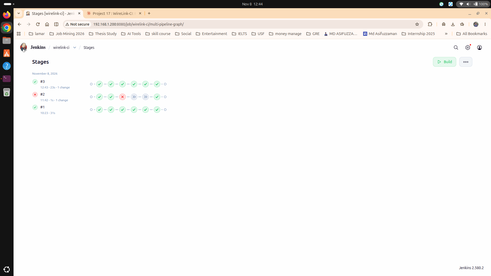

# WireLink-CI

A custom framed protocol over raw Layer-2 Ethernet, written in C, built with SCons, and tested by a Jenkins pipeline that drives a real cable between two machines.

A sender on an x86-64 Linux PC pushes frames over a physical Ethernet cable to a receiver on a Jetson Nano (ARM). The receiver checks every frame and reports exactly what it saw: frames received, CRC errors, sequence gaps, lost and duplicate frames. Jenkins builds the code, runs the unit tests, updates the receiver on the Jetson, and runs six link tests over the cable.

## Architecture

~~~mermaid
flowchart LR
  GH[GitHub repo] --> J
  subgraph Legion["Legion: x86-64, Ubuntu 24.04"]
    J[Jenkins 2.580.2] --> S[sender and pytest link tests]
  end
  S -- "raw Ethernet frames, EtherType 0x88B5" --> R
  subgraph Jetson["Jetson Nano: aarch64, Ubuntu 18.04"]
    R[receiver]
  end
  J -. "ssh: update code, build, start receiver" .-> R
~~~

The Legion's second port (`enp131s0`) is cabled directly to the Jetson's `eth0`. The same cable also carries ordinary IP traffic (`10.42.0.0/24`), which Jenkins uses for ssh and which gives the Jetson internet access. The test frames use their own EtherType, so the two do not mix.

## The frame

~~~
dst MAC (6) | src MAC (6) | EtherType 0x88B5 (2) | seq (4) | len (2) |
payload (0..1490) | CRC-32 (4)
~~~

All multi-byte fields are big-endian. The CRC-32 is written by hand (IEEE 802.3 polynomial, reflected, init and final XOR `0xFFFFFFFF`). It does not come from a library or from the NIC. The payload pattern is deterministic (byte `j` is `(uint8_t)(seq + j)`), so the receiver can verify payload content, not only the CRC.

## Layout

| Path | What it is |
|---|---|
| `src/frame.c`, `src/frame.h` | Frame build/parse and the hand-written CRC-32 |
| `src/rawsock.c`, `src/rawsock.h` | `AF_PACKET` raw socket helpers |
| `src/sender.c` | `sender <iface> <dst-mac> [--count N] [--size B] [--seq S] [--corrupt IDX] [--ethertype HEX] [--interval-us US]` |
| `src/receiver.c` | `receiver <iface> [--timeout SEC] [--idle SEC] [--verbose]` |
| `tests/test_frame.c` | 129 unit checks, including the standard CRC-32 test vector |
| `tests/test_link.py` | Six pytest link tests that run the real sender and receiver across the cable |
| `Jenkinsfile` | The pipeline |
| `assets/` | Jenkins screenshots and a packet capture of the link |
| `DEVLOG.md` | Dated engineering log, including what went wrong |

## Build and test

~~~
scons -Q            # build
scons -Q test       # 129 unit checks
~~~

Builds with `-std=c11 -Wall -Wextra -Werror -O2`. Verified on gcc 13/15 (x86-64) and gcc 7.5.0 with SCons 3.0.1 (Jetson, aarch64).

The link tests need two machines, a cable, and passwordless sudo for the sender and receiver binaries:

~~~
WL_TX_IF=enp131s0 WL_RX_MAC=00:00:00:00:00:01 WL_RX_IF=eth0 WL_RX_HOST=asif@10.42.0.11 \
  python3 -m pytest -q tests/test_link.py
~~~

The tests first check the carrier state on both ports and fail with a clear message if the cable is out.

## Pipeline

The `Jenkinsfile` has four stages: Build, Unit tests, Update receiver on Jetson (ssh, `git reset --hard` to the commit under test, `scons`), and Link tests. Results are published as JUnit.

Run history, kept on purpose:

- **#1 green:** all stages pass, including `6 passed` over the cable (`assets/jenkins-first-green.png`).
- **#2 red, deliberate:** I changed one digit of the CRC polynomial. The unit test for the standard vector `CRC-32("123456789") == 0xCBF43926` failed, the build stopped at Unit tests, and the Jetson and link stages were skipped (`assets/jenkins-red-run.png`).
- **#3 green:** the change was reverted and everything passed again.

Only 1 of the 129 checks failed in the red run. The other checks (round trips, parsing) stay self-consistent when the sender and receiver share a wrong polynomial, so a known-answer test against the published value is what actually protects the CRC.

## Results over the real cable

- Six link tests pass.
- `assets/wirelink-link.pcap` is a tcpdump capture of 6 frames on the wire.
- Unplug test: 60,000 frames sent while the cable was pulled and replugged. The receiver reported `rx=48081`, `gaps=1`, `lost=11919`, with no CRC errors, no duplicates, and no bad payloads. The gap was detected and counted exactly (`GAP expected=22487 got=34406`).
- The sender cannot tell that the link is dead: `sendto` succeeds with no carrier. That is why the tests read the carrier state and why the receiver does the accounting.

## Honest notes

- **Own protocol.** The framing and the CRC are my own implementation for learning and testing. This is not a standard protocol stack.
- **Not automotive.** The bench is a general-purpose PC and a Jetson Nano developer kit. It is not an automotive or embedded ECU, and nothing here is automotive Ethernet.
- **Lab bench.** One cable between two machines on a desk. No switch, no real network load, no timing guarantees.
- **Jenkins is local.** A single-node Jenkins on the Legion, reachable only on my home network (port 8080 over Wi-Fi). It is not a hosted CI service.
- **Security shortcuts, on purpose for a home bench.** Narrow passwordless sudo rules (the `jenkins` user can run the sender from its own workspace as root), ssh keys without passphrases, and a GitHub token stored in plain text on the Legion.
- **Hardware quirks.** The Jetson's `eth0` reports the MAC `00:00:00:00:00:01`, which is why the tests take the receiver MAC as a setting. The Jetson runs in the 5 W mode because it is powered from a USB port.
- **Unexplained.** A receiver started detached over ssh (`nohup ... &`) reported `rx=0` twice, while the same receiver started in the foreground worked. I worked around it (pytest starts the receiver attached) but did not find the root cause.

See `DEVLOG.md` for the full history.

## License

MIT. See `LICENSE`.
